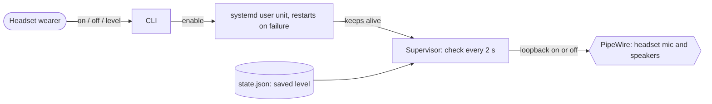

# airpods-max-sidetone

[](https://github.com/thefiredev-cloud/airpods-max-sidetone/actions/workflows/ci.yml)

Lets you hear your own voice in AirPods Max on Linux while you talk (sidetone). A small Python supervisor runs a PipeWire mic-to-ear loopback only while another app is recording from the headset mic, and caps the volume at about -18 dB.

It does not switch Bluetooth profiles, change default devices, play to any other speaker or use the network.

## How it works



Every 2 seconds the supervisor reads PipeWire state through `pactl`. The loopback runs only when the headset mic exists and is not muted, the headset speaker exists, and some other real app is capturing from that mic. Its own streams, monitors, filter chains and other microphones do not count.

When it starts the loopback, it creates two nodes that PipeWire will not auto-connect, sets the volume, reads it back, and refuses to go on if the reading is above the cap. Then it links exactly two ports. Each cycle it re-checks the volume and the link set; any extra or missing link stops the loopback. If a snapshot fails, the loopback stops. SIGTERM and SIGINT clean up before exit.

## Run

Needs Linux with PipeWire, Python 3 (standard library only), a systemd user session, and the headset connected in a profile that exposes its mic.

```bash
export SIDETONE_BT_ADDR=AA:BB:CC:DD:EE:FF   # from: bluetoothctl devices
python3 sidetone.py status                   # read-only
./install.sh                                 # writes the user unit for this clone
python3 sidetone.py on
```

| Command | Effect |
|---|---|
| `on` | Enables and starts `airpods-sidetone.service` |
| `off` | Stops it and reports any leftover loopback |
| `status [--json]` | Service state, gate decision, routing check, gain |
| `level <value>` | Saves and applies a level from 0.02 to 0.125 |
| `supervise` | Runs the loop in the foreground (the service uses this) |

`./uninstall.sh` removes the unit. Tool paths (`/usr/bin/pw-loopback`, `pw-link`, `pactl` and others), the cap and the interval are constants at the top of `sidetone.py`.

## Test

```bash
pip install pytest ruff && ruff check . && pytest -v
```

The 8 tests cover the gate decision and need no headset. CI runs them on Python 3.11.

## Status and limits

- Single file, no dependencies. Live routing, gain enforcement and the systemd unit have no automated tests; check them with `status`.
- Built for AirPods Max. Other Bluetooth headsets are untested.

More detail: [docs/ARCHITECTURE.md](docs/ARCHITECTURE.md).

## License

Copyright 2026 Tanner Osterkamp. All rights reserved. See [LICENSE](LICENSE). Contact: [tanner@kodros.ai](mailto:tanner@kodros.ai). Bugs: [issues](https://github.com/thefiredev-cloud/airpods-max-sidetone/issues).
