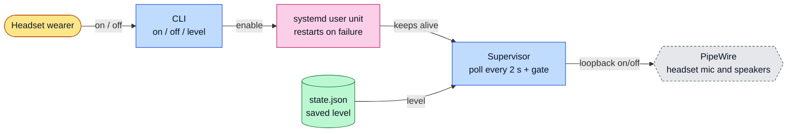
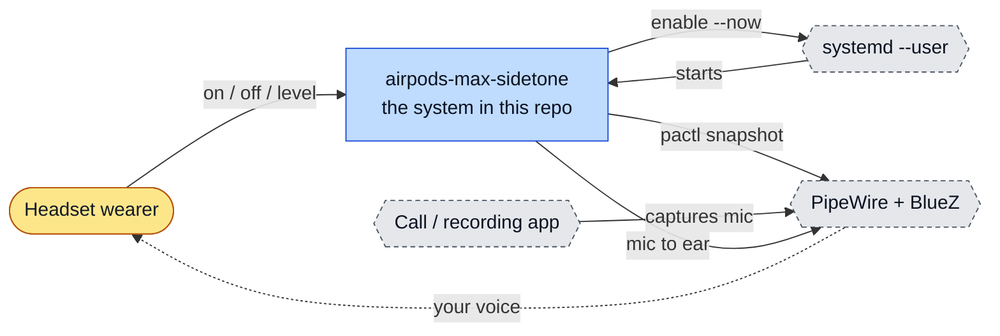
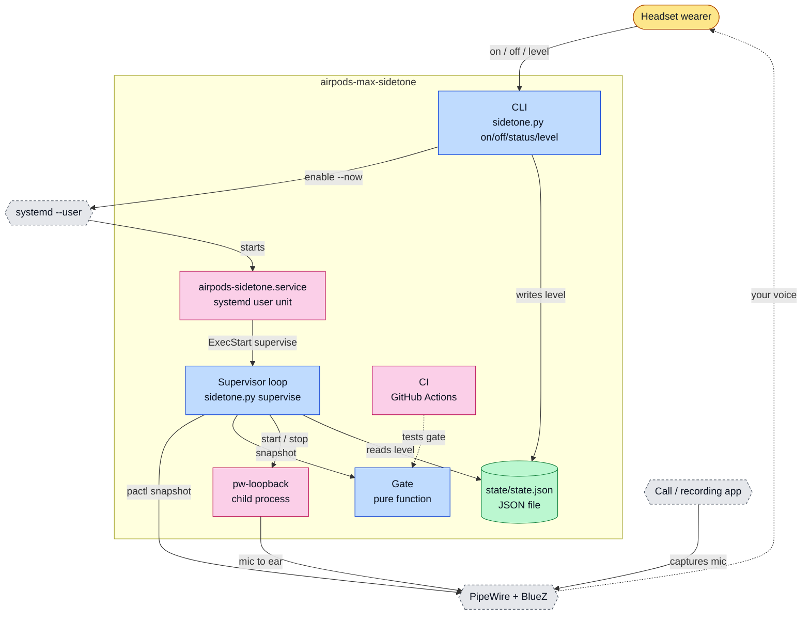
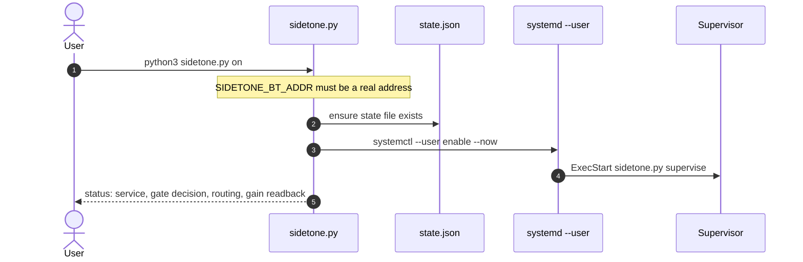
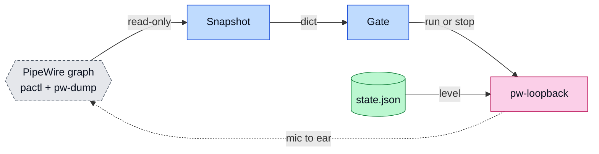
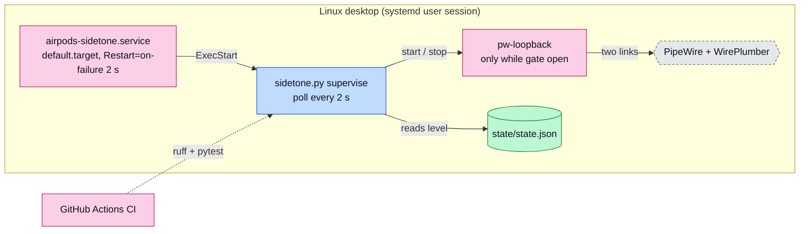
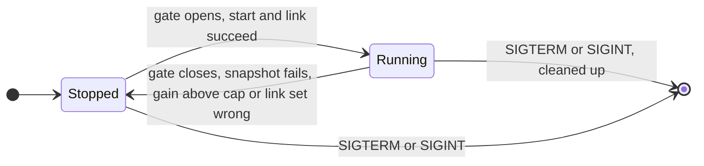

# airpods-max-sidetone: architecture

<!-- arch-kit:generated -->

> Whiteboard-level structure: what systems exist, what they talk to, and when they run. Evidence-backed; every box below maps to a path listed in [Evidence](#10-evidence).
> Generated by the ArchDocs kit from repo commit `92c8a6d03d`. Diagram sources: [`architecture/*.mmd`](architecture/). Hi-res renders sit next to each source.

## 1. Purpose

airpods-max-sidetone lets you hear your own voice in AirPods Max while you talk on Linux. One Python file, `sidetone.py`, polls PipeWire every 2 seconds. It starts a quiet `pw-loopback` from the headset mic to the headset speakers only while another application is capturing from that mic, caps the gain at 0.125 (about -18 dB), and tears everything down on any doubt. A systemd user unit keeps the supervisor alive. It uses the Python standard library only and never touches the network.

## 2. Whiteboard view

Six boxes. The loop only listens to PipeWire and only ever starts one quiet loopback.



Hi-res: [SVG](architecture/whiteboard.svg) · [PNG 3x](architecture/whiteboard@3x.png) · [dark SVG](architecture/whiteboard.dark.svg) · [dark PNG 3x](architecture/whiteboard.dark@3x.png)

Explorable version (Archify, standalone HTML, download and open locally): [`architecture/airpods-max-sidetone.archify.html`](architecture/airpods-max-sidetone.archify.html)

## 3. System context (C4 level 1)

Who and what touches the system from outside.



Hi-res: [SVG](architecture/context.svg) · [PNG 3x](architecture/context@3x.png)

## 4. Containers and components (C4 level 2)

The parts that run or hold data inside the repo's system boundary.



Hi-res: [SVG](architecture/containers.svg) · [PNG 3x](architecture/containers@3x.png)

| Container | Kind | Tech | What it does | Evidence |
|---|---|---|---|---|
| CLI | app | sidetone.py on/off/status/level | Enables the unit, reads status, saves the loopback level (clamped 0.02 to 0.125). | [`sidetone.py#L430-L463`](../sidetone.py#L430-L463), [`sidetone.py#L470-L486`](../sidetone.py#L470-L486) |
| Supervisor loop | app | sidetone.py supervise | Every 2 s: snapshot, gate, start/verify/stop the loopback. Fails closed. | [`sidetone.py#L307-L369`](../sidetone.py#L307-L369) |
| Gate | app | pure function | Runs only if the headset source and sink exist, the source is unmuted, and another real capture client records from it. | [`sidetone.py#L141-L169`](../sidetone.py#L141-L169), [`tests/test_gate.py`](../tests/test_gate.py) |
| pw-loopback | job | child process | Two mono streams, autoconnect off, linked by exactly two pw-link calls. | [`sidetone.py#L208-L255`](../sidetone.py#L208-L255) |
| state/state.json | store | JSON file | The saved loopback level. Created on first use, ignored by git. | [`sidetone.py#L59-L60`](../sidetone.py#L59-L60), [`sidetone.py#L281-L299`](../sidetone.py#L281-L299) |
| airpods-sidetone.service | job | systemd user unit | Runs `supervise`, Restart=on-failure every 2 s, kills leftover pw-loopback on stop. | [`systemd/airpods-sidetone.service#L10-L14`](../systemd/airpods-sidetone.service#L10-L14) |
| CI | job | GitHub Actions | ruff check and pytest on Python 3.11. | [`.github/workflows/ci.yml`](../.github/workflows/ci.yml) |

## 5. Key runtime sequences

### 5.1 One supervisor cycle with the gate open

Runs every 2 seconds. A failed snapshot stops the loopback instead of guessing.

```mermaid
sequenceDiagram
  autonumber
  participant sup as Supervisor
  participant pactl as pactl / pw-dump
  participant gate as Gate
  participant lb as pw-loopback
  participant link as pw-link
  sup->>pactl: list sources, sinks, capture streams
  pactl-->>sup: snapshot
  sup->>gate: evaluate_gate(snapshot)
  gate-->>sup: run = true (real capture client present)
  alt no loopback yet
    sup->>lb: start with autoconnect off
    sup->>lb: set playback volume, read it back
    Note over sup: readback above 0.125: stop and clean up
    sup->>link: link exactly two ports
  else loopback running
    sup->>lb: reapply level if readback above cap
    sup->>pactl: verify exactly two links
  end
```

Hi-res: [SVG](architecture/sequence-1.svg) · [PNG 3x](architecture/sequence-1@3x.png)

### 5.2 Turning sidetone on



Hi-res: [SVG](architecture/sequence-2.svg) · [PNG 3x](architecture/sequence-2@3x.png)

## 6. Data flow and stores

Only one value is persisted: the level. Everything else is re-derived from PipeWire every cycle.



Hi-res: [SVG](architecture/dataflow.svg) · [PNG 3x](architecture/dataflow@3x.png)

| Store | What it holds | Written by | Evidence |
|---|---|---|---|
| state/state.json | The saved loopback level, clamped to 0.02..0.125. | CLI `level` and `on` | [`sidetone.py#L281-L299`](../sidetone.py#L281-L299) |

## 7. Deployment and runtime topology

One process on one desktop. systemd keeps it alive; the loopback child exists only while the gate is open.



Hi-res: [SVG](architecture/deployment.svg) · [PNG 3x](architecture/deployment@3x.png)

| What | Where | Runs when | Trigger / port | Evidence |
|---|---|---|---|---|
| Supervisor cycle | systemd user unit | Every 2 s while the unit is active | INTERVAL = 2.0 | [`sidetone.py#L50`](../sidetone.py#L50), [`sidetone.py#L319-L366`](../sidetone.py#L319-L366) |
| Unit restart | systemd | 2 s after a failure | Restart=on-failure, RestartSec=2 | [`systemd/airpods-sidetone.service#L12-L13`](../systemd/airpods-sidetone.service#L12-L13) |
| Loopback | PipeWire | Only while another app captures the headset mic | gate | [`sidetone.py#L141-L169`](../sidetone.py#L141-L169) |
| CI | GitHub Actions | Push and pull request to main | .github/workflows/ci.yml | [`.github/workflows/ci.yml`](../.github/workflows/ci.yml) |

## 8. Failure modes and how to see them

| Failure | What the user sees | How to see it | Evidence |
|---|---|---|---|
| pactl or pw-dump snapshot fails | Sidetone stops; retried next cycle | log line `snapshot failed ... fail-closed`; `status` | [`sidetone.py#L324-L330`](../sidetone.py#L324-L330) |
| Gain readback above 0.125 after reapplying | Loopback stopped | log `gain unenforceable -> stopped` | [`sidetone.py#L345-L355`](../sidetone.py#L345-L355) |
| Extra or missing PipeWire link | Loopback stopped and restarted from scratch | log `routing drift -> stopping from scratch`; `status` routing check | [`sidetone.py#L356-L360`](../sidetone.py#L356-L360), [`sidetone.py#L171-L198`](../sidetone.py#L171-L198) |
| Placeholder or malformed SIDETONE_BT_ADDR | Process exits at import | SystemExit message naming the variable | [`sidetone.py#L40-L43`](../sidetone.py#L40-L43), [`sidetone.py#L425-L427`](../sidetone.py#L425-L427) |
| Supervisor killed | systemd restarts it; stray pw-loopback killed on stop | `systemctl --user status airpods-sidetone` | [`systemd/airpods-sidetone.service#L11-L13`](../systemd/airpods-sidetone.service#L11-L13) |

## 9. State machine

The loopback's life inside the supervisor.



Hi-res: [SVG](architecture/state.svg) · [PNG 3x](architecture/state@3x.png)

## 10. Evidence

Every path below exists at the pinned commit; links are relative to `docs/`.

| Path | Why it matters |
|---|---|
| [`sidetone.py#L307-L369`](../sidetone.py#L307-L369) | The supervisor loop: snapshot, gate, start, cap check, routing check, stop, signals. |
| [`sidetone.py#L141-L169`](../sidetone.py#L141-L169) | Pure gate function (tested without PipeWire). |
| [`sidetone.py#L208-L255`](../sidetone.py#L208-L255) | Loopback start: node properties, volume, links. |
| [`sidetone.py#L40-L60`](../sidetone.py#L40-L60) | Constants: cap 0.125, interval 2 s, tool paths, state file. |
| [`systemd/airpods-sidetone.service`](../systemd/airpods-sidetone.service) | User unit: ExecStart supervise, restart policy, ExecStopPost cleanup. |
| [`tests/test_gate.py`](../tests/test_gate.py) | The 8 gate tests. |
| [`.github/workflows/ci.yml`](../.github/workflows/ci.yml) | ruff and pytest on Python 3.11. |
| [`install.sh`](../install.sh) | Writes the user unit for this clone and reloads systemd. |
| [`README.md`](../README.md) | Behavior, requirements and known gaps (no live-routing tests). |

Collected mechanically by the kit ([`architecture/facts.json`](architecture/facts.json), not hand-edited):

- entry points: `python-script-main`
- CI: `.github/workflows/ci.yml`

Graphify (local AST, no LLM) read this repo: 80 nodes, 148 edges, 8 communities. Most connected: `supervise()` (17), `start_loopback()` (12), `run()` (11), `node_id()` (10), `gather_status()` (9).

- Report: [`architecture/graphify/GRAPH_REPORT.md`](architecture/graphify/GRAPH_REPORT.md)
- Interactive graph: [`architecture/graphify/graph.html`](architecture/graphify/graph.html) (79 KB, download and open locally)
